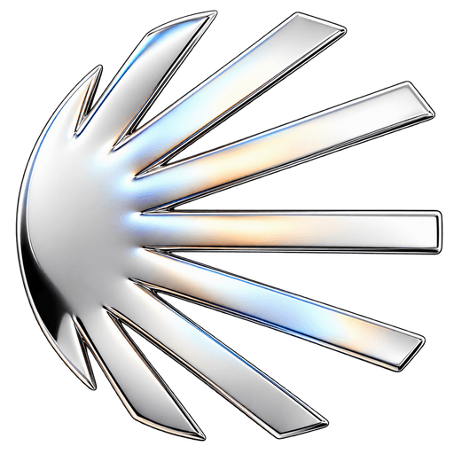
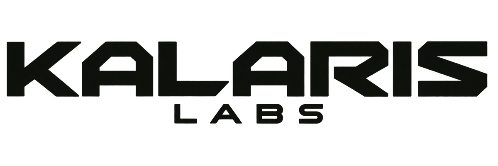
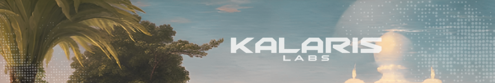

**Original logo marks, colour tokens and typography for Kalaris Labs.** This page mirrors
[kalarislabs.com/brand](https://kalarislabs.com/brand). Each preview is the production file. For company facts and
the boilerplate, see the [press kit](/lab/press).

## Logos

| Asset | Use it for | File | Download |
|---|---|---|---|
| Mark | Icons, avatars and contained symbol surfaces | PNG, 1254 × 1254, 1.3 MB | [kalaris-mark.png](https://kalarislabs.com/brand/kalaris-mark.png) |
| Wordmark, white | Dark backgrounds; the footer signature | PNG, 2172 × 724, 311 KB | [kalaris-wordmark-white.png](https://kalarislabs.com/brand/kalaris-wordmark-white.png) |
| Wordmark, black | Light backgrounds; the navigation brand | PNG, 1200 × 400, 107 KB | [kalaris-wordmark-black.png](https://kalarislabs.com/brand/kalaris-wordmark-black.png) |
| App icon | Apps, bookmarks and home screens | PNG, 512 × 512, 67 KB | [512 px](https://kalarislabs.com/brand/app-icon-512.png), [180 px](https://kalarislabs.com/brand/app-icon-180.png), [64 px favicon](https://kalarislabs.com/brand/favicon-64.png) |
| Social banner | Link previews and presentations | PNG, 1024 × 173, 320 KB | [kalaris-banner.png](https://kalarislabs.com/brand/kalaris-banner.png) |

<Columns cols={2}>
  <Frame caption="Mark">
    
  </Frame>
  <Frame caption="App icon">
    
  </Frame>
  <Frame caption="Wordmark: black on light, white on dark">
    
    
  </Frame>
  <Frame caption="Social banner">
    
  </Frame>
</Columns>

## Colour

Black is the default: dark is the brand, not a theme variant. Use blue sparingly, for actions and active states.
Green marks live status only.

| Name | Hex | Use | Token |
|---|---|---|---|
| Black | `#050505` | Page background | `--kalaris-black` |
| Panel | `#0a0a0b` | Sections and controls | `--kalaris-panel` |
| Raised | `#101012` | Hover and raised states | `--kalaris-panel-raised` |
| Ink | `#f0eee8` | Primary text | `--kalaris-ink` |
| Subtle | `#949497` | Supporting copy | `--kalaris-subtle` |
| Line | `#29292c` | Dividers and borders | `--kalaris-line` |
| Blue | `#4d7cff` | Primary action, active state | `--kalaris-blue` |
| Green | `#38d995` | Live and available status only | `--kalaris-green` |

## Type

| Typeface | Role | Weights |
|---|---|---|
| Manrope | Display and body | Regular 400, Medium 500, Semibold 600, Bold 700 |
| DM Mono | Technical labels | Light 300, Regular 400, Medium 500 |

Both are free from Google Fonts. These docs set headings in Geist Serif for long-form reading.

## Using the marks

**Do**

- Use the wordmark for headers and signatures, and the mark for icons.
- Place the white wordmark on dark and the black wordmark on light.
- Keep clear space around every mark and preserve its proportions.
- Write the name as "Kalaris Labs".

**Don't**

- Recolour, stretch, rotate, outline or add effects to a mark.
- Rebuild a mark with live text or substitute glyphs.
- Place a mark on a busy or low-contrast background.
- Imply endorsement, partnership or affiliation without written agreement from Kalaris Labs.

## Install the kit

Download the zip, or pull it from a terminal. For production, self-host the files rather than linking to
kalarislabs.com.

<CodeGroup>
```bash macOS and Linux
curl -fsSLO https://kalarislabs.com/brand/kalaris-brand-kit.zip
unzip kalaris-brand-kit.zip
```

```powershell Windows
Invoke-WebRequest https://kalarislabs.com/brand/kalaris-brand-kit.zip -OutFile kalaris-brand-kit.zip
Expand-Archive kalaris-brand-kit.zip -DestinationPath .
```
</CodeGroup>

<CodeGroup>
```html Fonts
<link rel="preconnect" href="https://fonts.googleapis.com" />
<link rel="preconnect" href="https://fonts.gstatic.com" crossorigin />
<link
  rel="stylesheet"
  href="https://fonts.googleapis.com/css2?family=DM+Mono:wght@300;400;500&family=Manrope:wght@400;500;600;700&display=swap"
/>
```

```html Colour and font tokens
<link rel="stylesheet" href="https://kalarislabs.com/brand/colors.css" />
```

```html Favicon and app icons
<link rel="icon" type="image/png" sizes="64x64" href="/favicon-64.png" />
<link rel="apple-touch-icon" sizes="180x180" href="/app-icon-180.png" />
```

```html Embed the wordmark

```
</CodeGroup>

## Need something else?

For a different format or a use not covered here, email
[hello@kalarislabs.com](mailto:hello@kalarislabs.com?subject=Brand%20request).
