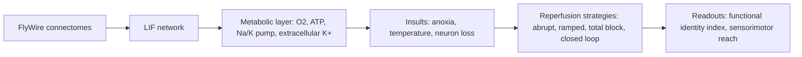

**Bottom line:** In a model of the whole adult fly brain (139,255 neurons, FlyWire FAFB v783), switching oxygen back on abruptly after a 180-second outage traps the network in a self-sustaining high-activity state, and its stimulus-response identity does not return. A 20-second total activity block at reperfusion resets it, and the identity returns.

<Warning>
This is a simplified simulation: leaky integrate-and-fire neurons on a real wiring diagram, with a phenomenological K⁺/ATP layer whose constants were not fitted to *Drosophila*. It is a source of testable predictions, not evidence about living tissue. No real brain was revived.
</Warning>

| | |
|---|---|
| **Author** | Srihari Muralikrishnan ([ORCID 0009-0004-0220-0361](https://orcid.org/0009-0004-0220-0361)), Kalaris Labs |
| **Published** | 2026, preprint with code |
| **Evidence** | Results come from simulation. |
| **Data** | FlyWire Codex FAFB v783, MCNS v1.0, BANC v888, MANC v1.2.1 |
| **License** | Code MIT; connectome data under the FlyWire principles |
| **Theme** | [Cognition and neuroscience](/research#cognition-and-neuroscience) |

<Columns cols={2}>
  <Card title="Paper and code" icon="github" href="https://github.com/KalarisLabs/fly-brain-resuscitation">
    Paper, supplement, simulator, experiment definitions and figure scripts.
  </Card>
  <Card title="Agent tooling used" icon="book-open" href="/research-agent-skills">
    The study used Kalaris Labs Myriad and Research Agent Skills.
  </Card>
</Columns>

## How the model works



## Key results

| # | Result | Evidence | Confidence |
|:-:|---|---|---|
| 1 | After 180 s anoxia, abrupt reperfusion traps the model in a self-sustained runaway | 48/48 FAFB parameter sets; 5/5 MCNS runs | High |
| 2 | After 30 s anoxia, the trap depends on whether antennal-lobe local neurons are inhibitory | FAFB 0/3 runaway; MCNS FII<sub>norm</sub> 1.000 | Moderate |
| 3 | A 20 s total block at reperfusion restores the stimulus-response map; 2–5 s blocks fail | FAFB FII<sub>norm</sub> 1.001 / 0.953 at 30 / 180 s | High |
| 4 | Releasing the block as soon as K⁺ and ATP normalise (11 s) is not enough | MCNS 5/5 runaway | Moderate |
| 5 | The trapped state is ionic, not synaptic | 109/134 Hz with synapses off; 2.4/2.3 Hz with K⁺ clamp | High (model) |
| 6 | Model brain death needed near-total neuron death | All 92 such runs had ≥ 97.9% dead | High (model) |
| 7 | Protecting the top 1% most-connected neurons is far more efficient than whole-brain protection | ~30× FAFB; 84× MCNS | High |
| 8 | Graded reperfusion did not beat abrupt reperfusion plus a block | Pre-registered H3 falsified | High (model) |
| 9 | Hub-targeted neuron loss is far more destructive than random loss | FAFB f<sub>c</sub> 0.800 random vs 0.033 hub-targeted | High (direction) |

## Limitations

The model cannot represent oxidative stress, inflammation, glia, the blood-brain barrier, synaptic plasticity or memory storage. "Identity" means the stimulus-response map of a fixed wiring diagram, not memories or experience. The repository includes a proposed real-fly validation protocol (optogenetic silencing at reoxygenation, proboscis-extension and escape readouts).

## Reproduce

```bash
git clone https://github.com/KalarisLabs/fly-brain-resuscitation.git
cd fly-brain-resuscitation
conda env create -f environment.yml && conda activate flybrain
pytest -q
```

Connectome tables are not redistributed. Download them from [FlyWire Codex](https://codex.flywire.ai/).

## Related research

- [The Felt Edge](/research/papers/the-felt-edge): As machines commoditise processing, recall and problem solving, this paper argues that felt metacognition is the residual human edge, and that it is trainable.
- [Inventing the Variable](/research/papers/inventing-the-variable): The HiddenLaw benchmark tests whether AI can introduce a variable its vocabulary lacks. Passive data blocks every learner; with interventions, Claude Opus 5.5 succeeds in 9 of 9 worlds.

## Cite this study

```bibtex
@misc{muralikrishnan2026flybrain,
  title  = {Anoxia, brain death and resuscitation in a connectome-constrained simulation of the adult Drosophila brain},
  author = {Muralikrishnan, Srihari},
  year   = {2026},
  note   = {Preprint, Kalaris Labs},
  url    = {https://github.com/KalarisLabs/fly-brain-resuscitation}
}
```
